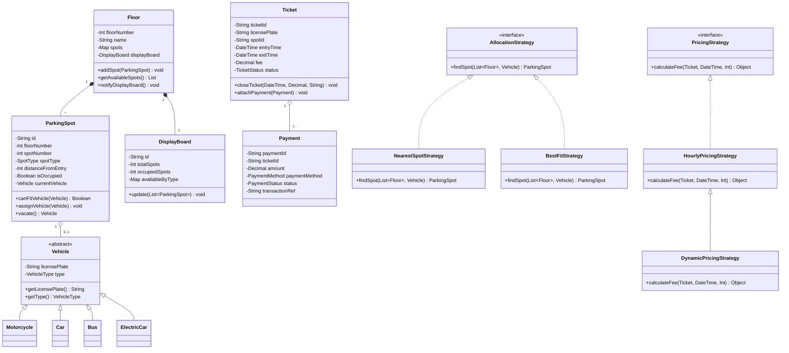
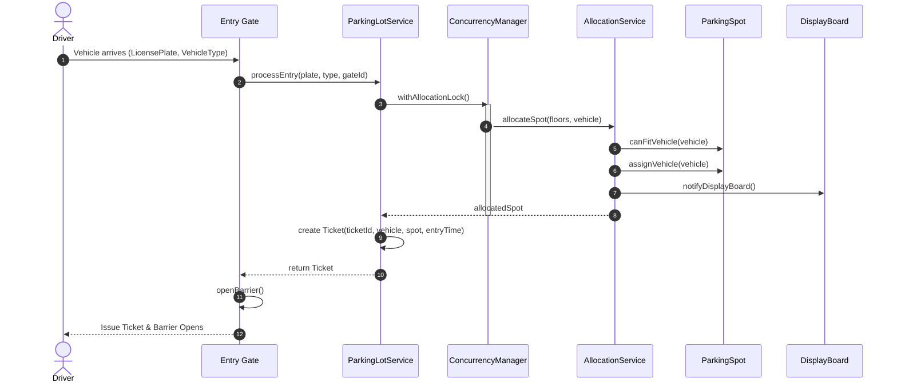
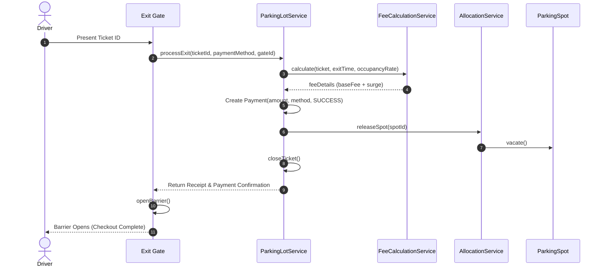
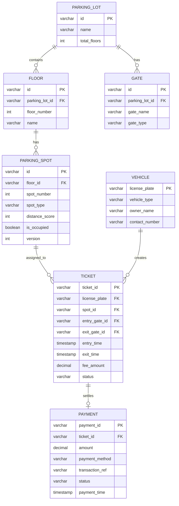

# Smart Parking Lot System - Low-Level Design (LLD)

[](https://nodejs.org/)
[](LICENSE)
[-brightgreen.svg)]()
[]()
[]()

> **Project Objective**: Low-Level Design (LLD) and object-oriented backend architecture for an urban multi-floor smart parking lot system. The system automates vehicle entry and exit management, parking space allocation based on vehicle size and proximity, real-time availability updates across floors, dynamic fee calculations, and multi-gate concurrency control to prevent double booking.

---

## 📑 Table of Contents
1. [Core Requirements & Features](#-core-requirements--features)
2. [Object-Oriented Design & Design Patterns](#-object-oriented-design--design-patterns)
3. [Architecture & UML Diagrams](#-architecture--uml-diagrams)
   - [Class Diagram](#class-diagram)
   - [Vehicle Check-In Flow (Sequence Diagram)](#vehicle-check-in-flow)
   - [Vehicle Check-Out Flow (Sequence Diagram)](#vehicle-check-out-flow)
   - [Database Entity-Relationship (ER) Diagram](#database-entity-relationship-er-diagram)
4. [Spot Allocation Algorithm](#-spot-allocation-algorithm)
5. [Fee Calculation & Dynamic Pricing](#-fee-calculation--dynamic-pricing)
6. [Concurrency & Race Condition Handling](#-concurrency--race-condition-handling)
7. [Database Schema DDL](#-database-schema-ddl)
8. [Project Structure](#-project-structure)
9. [How to Run the LLD Simulation (`main.js`)](#-how-to-run-the-lld-simulation-mainjs)
10. [Running the Test Suite](#-running-the-test-suite)

---

## 🎯 Core Requirements & Features

1. **Automatic Spot Allocation**:
   - Assigns available parking spots based on vehicle type:
     - `MOTORCYCLE`: Fits in `SMALL`, `MEDIUM`, or `LARGE` spots.
     - `CAR`: Fits in `MEDIUM` or `LARGE` spots.
     - `BUS` / `TRUCK`: Fits strictly in `LARGE` spots.
     - `ELECTRIC`: Fits in `ELECTRIC` (with EV charging) or `MEDIUM`/`LARGE` spots.
   - Configurable strategies: **Nearest Spot Strategy** (lowest floor + minimal walking distance) or **Best Fit Strategy** (smallest compatible spot type to avoid resource waste).

2. **Check-In & Check-Out Management**:
   - Generates unique parking tickets upon arrival at any entrance gate.
   - Records license plate, assigned spot ID, floor number, timestamp, and gate.
   - Prevents duplicate check-in attempts for vehicles already in the facility.

3. **Dynamic Fee Calculation**:
   - **15-minute Grace Period**: Exiting within 15 minutes incurs **\$0** fee.
   - **Hourly Rates**: Tiered by vehicle type (`Motorcycle: $10/hr`, `Car: $20/hr`, `EV: $25/hr`, `Bus: $50/hr`).
   - **Occupancy Surge Pricing**: Real-time multiplier triggers when parking occupancy exceeds 80% (1.5x) or 95% (2.0x).
   - Partial hours are rounded up.

4. **Real-Time Display Boards (Observer Pattern)**:
   - Digital display boards at each floor entrance and main entry gate update counts automatically when spots are occupied or vacated.

5. **Multi-Gate Concurrency Control**:
   - Multiple entry and exit gates operate concurrently.
   - Asynchronous Mutex locks prevent race conditions and eliminate double booking.

---

## 🏗️ Object-Oriented Design & Design Patterns

The architecture strictly adheres to **SOLID** principles:

| Design Pattern | Component | Purpose |
| :--- | :--- | :--- |
| **Strategy Pattern** | `AllocationStrategy`<br>`NearestSpotStrategy`<br>`BestFitStrategy` | Encapsulates spot search algorithms and allows switching allocation policies at runtime without modifying client code. |
| **Strategy Pattern** | `PricingStrategy`<br>`HourlyPricingStrategy`<br>`DynamicPricingStrategy` | Decouples fee calculation logic from ticket checkout, enabling surge pricing or special rate cards. |
| **Factory Pattern** | `VehicleFactory`<br>`SpotFactory` | Centralizes creation and validation of vehicles and parking spots. |
| **Observer Pattern** | `DisplayBoard`<br>`Floor.notifyDisplayBoard()` | Floor and master display boards subscribe to spot occupancy changes and update real-time counts automatically. |
| **Singleton / Facade** | `ParkingLotService` | Serves as the central API facade coordinating gates, floors, allocation, tickets, and concurrency locks. |
| **Mutex / Lock Pattern** | `ConcurrencyManager` | Serializes critical spot allocation sections across parallel gates to guarantee zero double-booking. |

---

## 📊 Architecture & UML Diagrams

### Class Diagram



---

### Vehicle Check-In Flow



---

### Vehicle Check-Out Flow



---

### Database Entity-Relationship (ER) Diagram



---

## 🧠 Spot Allocation Algorithm

1. **Nearest Spot Strategy (`NearestSpotStrategy`)**:
   - Searches floors starting from Floor 1 upwards.
   - Evaluates each spot's distance weight:
     $$\text{distanceWeight} = (\text{floorNumber} \times 100) + (\text{spotNumber} \times 5)$$
   - Identifies candidate spots compatible with the vehicle size via `spot.canFitVehicle(vehicle)`.
   - Returns the spot minimizing walking distance to entry.

2. **Best Fit Strategy (`BestFitStrategy`)**:
   - Eliminates resource starvation (e.g. a motorcycle parking in an oversized bus spot).
   - Priority matching order:
     - `MOTORCYCLE`: `SMALL` $\rightarrow$ `MEDIUM` $\rightarrow$ `LARGE`
     - `CAR`: `MEDIUM` $\rightarrow$ `LARGE`
     - `BUS`: `LARGE`
     - `ELECTRIC`: `ELECTRIC` $\rightarrow$ `MEDIUM` $\rightarrow$ `LARGE`
   - Selects the smallest compatible spot tier, breaking internal ties by distance.

---

## 💰 Fee Calculation & Dynamic Pricing

- **Grace Period**: If parking duration $\le 15$ minutes, fee is **\$0.00**.
- **Standard Base Hourly Rates**:
  - `MOTORCYCLE`: **\$10.00** / hour
  - `CAR`: **\$20.00** / hour
  - `ELECTRIC`: **\$25.00** / hour (includes charging station power)
  - `BUS`: **\$50.00** / hour
- **Billable Hours**: Partial hours are rounded up ($\lceil \text{minutes} / 60 \rceil$).
- **Dynamic Surge Multiplier**:
  $$\text{Multiplier} = \begin{cases} 2.0\times & \text{if Occupancy} \ge 95\% \\ 1.5\times & \text{if Occupancy} \ge 80\% \\ 1.0\times & \text{otherwise} \end{cases}$$
  $$\text{Total Fee} = \lceil \text{Billable Hours} \times \text{Hourly Rate} \times \text{Multiplier} \rceil$$

---

## 🔒 Concurrency & Race Condition Handling

When multiple vehicles arrive at simultaneous entrance gates (e.g. Gate 1 and Gate 2) within the same millisecond:
- Without concurrency protection, two incoming cars would read the same available spot as free and receive duplicate tickets for the same physical slot.
- **Solution**: The `ConcurrencyManager` introduces an asynchronous Mutex mechanism around the allocation critical section:
  ```javascript
  await concurrencyManager.withAllocationLock(async () => {
    const spot = allocationService.allocateSpot(floors, vehicle);
    spot.assignVehicle(vehicle);
    // Spot is marked occupied atomically before next queued request evaluates availability
  });
  ```
- **Verification**: Verified under heavy multi-threading simulation (`tests/concurrency/concurrency.test.js`), confirming **100% unique spot assignments** and zero duplicate bookings.

---

## 🗄️ Database Schema DDL

The complete relational database DDL with foreign keys, indexes, and constraints is provided in [`db/schema.sql`](db/schema.sql).

Highlights:
- **`parking_spots`**: Indexed on `(floor_id, spot_type, is_occupied)` for $O(1)$ filtered spot lookup.
- **`tickets`**: Indexed on active status `status = 'ACTIVE'` and `license_plate`.
- **Optimistic Locking**: `version INT DEFAULT 1` column on spots for high-throughput distributed database replication.

---

## 📁 Project Structure

```
smart-parking-lot-system-bhaskarreddydn/
├── db/
│   └── schema.sql                     # Relational database DDL, indexes, seed data
├── src/
│   ├── config/
│   │   └── pricingConfig.js           # Rates, grace periods, surge rules
│   ├── factories/
│   │   ├── SpotFactory.js             # Factory for ParkingSpot instances
│   │   └── VehicleFactory.js          # Factory for Vehicle instances
│   ├── models/
│   │   ├── DisplayBoard.js            # Observer Pattern display boards
│   │   ├── Floor.js                   # Floor aggregate managing spots
│   │   ├── Gate.js                    # Entry & Exit gate models
│   │   ├── ParkingSpot.js             # Spot model & compatibility logic
│   │   ├── Payment.js                 # Payment transaction model
│   │   ├── Ticket.js                  # Ticket lifecycle model
│   │   └── Vehicle.js                 # Motorcycle, Car, Bus, ElectricCar
│   ├── services/
│   │   ├── AllocationService.js       # Spot search & reservation logic
│   │   ├── ConcurrencyManager.js      # Mutex locks preventing race conditions
│   │   ├── FeeCalculationService.js   # Dynamic fee calculation orchestrator
│   │   └── ParkingLotService.js       # Singleton facade & root aggregate
│   └── strategies/
│       ├── allocation/                # Strategy Pattern: Spot Allocation
│       │   ├── AllocationStrategy.js
│       │   ├── BestFitStrategy.js
│       │   └── NearestSpotStrategy.js
│       └── pricing/                   # Strategy Pattern: Fee Calculation
│           ├── DynamicPricingStrategy.js
│           ├── HourlyPricingStrategy.js
│           └── PricingStrategy.js
├── tests/
│   ├── concurrency/
│   │   └── concurrency.test.js        # High-traffic race condition stress tests
│   └── unit/
│       ├── allocation.test.js         # Strategy pattern allocation tests
│       ├── models.test.js             # Domain models unit tests
│       └── pricing.test.js            # Fee calculation & surge tests
├── main.js                            # Interactive LLD Driver / Client Simulation
├── package.json                       # Scripts and project metadata (0 runtime dependencies)
└── README.md                          # Comprehensive documentation & architecture guide
```

---

## 🚀 How to Run the LLD Simulation (`main.js`)

The `main.js` driver program demonstrates all aspects of the design interactively:

```bash
node main.js
```

Or using npm:
```bash
npm start
```

### What `main.js` demonstrates:
1. **Floor & Spot Hierarchy Setup**: Initializes 3 floors with small, medium, large, and electric spots.
2. **Vehicle Entry & Strategy Allocation**: Parks a Motorcycle, Car, Bus, and EV using the `NearestSpotStrategy`.
3. **Display Board Updates**: Verifies real-time count changes via the Observer pattern.
4. **Concurrency Stress Test**: Dispatches 10 simultaneous vehicle arrivals across Gate 1 and Gate 2 at the exact same millisecond, verifying zero double-booking.
5. **Fee Calculation & Checkout**: Demonstrates Grace Period (\$0 fee), standard hourly rates, and heavy vehicle pricing.

---

## 🧪 Running the Test Suite

The test suite runs using Node.js's native test runner (zero third-party test dependencies):

```bash
# Run all tests (unit + concurrency)
npm test

# Run only concurrency stress tests
npm run test:concurrency

# Run unit tests
npm run test:unit
```
